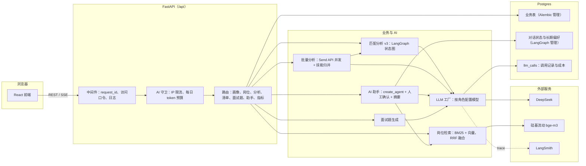

# CareerMatch 架构

前端和后端部署在同一个 Vercel 项目里，`/api/*` 交给 FastAPI，其余路径交给
Vite 构建的前端。业务数据、对话状态、长期偏好和检索索引都在同一个 Postgres
（Neon）里。也可以用 `docker-compose.yml` 自托管。

## CareerMatch 的分层

- **接入层**：`app/main.py` 的中间件给每个请求分配 request_id、校验访问口令
  （配置后为只读演示）、记录访问日志；`app/core/guard.py` 对调用 AI 的接口
  做 IP 限流和每日 token 预算。
- **编排层**：匹配分析是 LangGraph 状态图（规则筛选、条件路由、节点级重试），
  批量分析用 Send API 并发；AI 助手用 `create_agent`，写操作经
  HumanInTheLoopMiddleware 中断等确认，长对话自动摘要。
- **能力层**：`app/llm/factory.py` 按角色返回模型，换模型只改配置；
  检索在 `app/services/retrieval.py`；所有 LLM 调用经回调写日志和 `llm_calls`。
- **数据层**：业务表由 Alembic 迁移；LangGraph 的 checkpointer 和 Store
  自己建表，Alembic 会忽略它们。
- **观测与评测**：结构化日志、LangSmith 链路追踪、`/api/metrics` 线上指标；
  `backend/evals/` 是离线评测，详见 [evals.md](evals.md)。

关键设计决策和取舍见 [decisions.md](decisions.md)。
